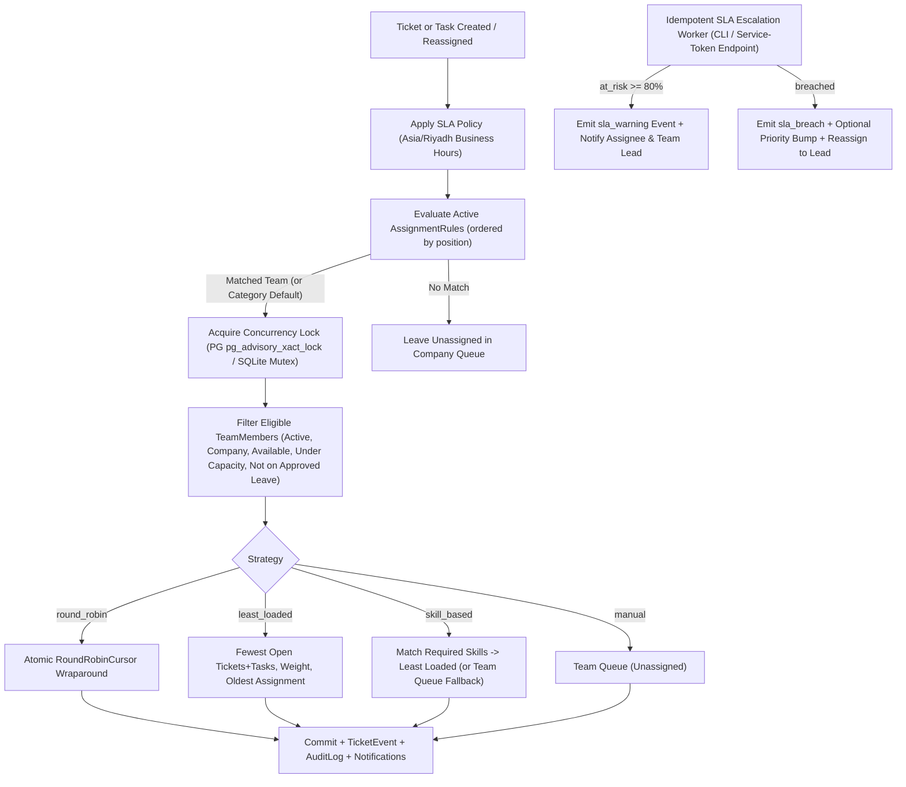

# Investor Gate IT Operations Management System — Architecture Document

## 1. System Overview
**Investor Gate IT Operations Management System** is a secure, self-hosted, multi-company platform designed for enterprise IT governance across distributed branches and subsidiary organizations.

### Primary Objectives
- Zero recurring software licensing or cloud hosting costs (100% Free and Open Source Software stack).
- Native Arabic Right-to-Left (RTL) interface (`IBM Plex Sans Arabic`) with full English (`Inter`) support.
- Hard multi-tenant company isolation and 6-role RBAC enforced server-side.
- Strict 9-module enterprise scope:
  1. **Dashboard (`لوحة المتابعة` — `/`):** Real-time asset, ticket, task, employee, and branch KPIs with SVG status distribution charts.
  2. **Companies & Branches (`الشركات والفروع` — `/companies`):** Group hierarchy (`IGT` parent, `BLB` and `INV` subsidiaries) and the 5 canonical physical branches (`الرياض – السلي (مخرج 17)`, `الرياض – الفيصلية (مخرج 18)`, `الرياض – العليا`, `الدمام`, `جدة`).
  3. **Employees (`الموظفون` — `/employees`, `/employees/[id]`):** Unified employee directory with Arabic fuzzy search (`rapidfuzz`), multi-branch assignments, and 360° employee profile.
  4. **Assets & Custody (`الأصول والعهد` — `/assets`, `/custody`):** Hardware inventory, QR generation, and atomic custody assignment/transfer/return receipts.
  5. **Subscriptions (`الاشتراكات` — `/subscriptions`):** SaaS/cloud license tracking, renewal forecasting, and `employee_subscriptions` M:N seat allocation.
  6. **Help Desk (`الدعم الفني` — `/tickets`):** Support tickets with race-safe sequential numbering (`TCK-YYYY-####`), SLA tracking, and internal technician notes isolation.
  7. **Tasks & Deadlines (`المهام` — `/tasks`):** Multi-stage collaborative task workflow with real-time 3-second version polling and interactive Telegram Bot callbacks.
  8. **Reports (`التقارير` — `/reports`):** Executive KPIs, company breakdown, UTF-8 BOM CSV/Excel exports, and printable HTML/PDF reports.
  9. **Settings (`الإعدادات` — `/settings`, `/settings/*`, `/users`, `/audit`, `/notifications`, `/digital-assets`, `/infrastructure`, `/maintenance`):** System administration, user/role management, appearance/branding, Telegram/n8n integrations, zero-plaintext secrets vault, and SHA-256-verified database backup & restore.

---

## 2. Technical Stack

```
+---------------------------------------------------------------------------------+
|                                USER INTERFACE                                   |
|   Next.js 16 (App Router, Standalone) + React 19 + TypeScript + Tailwind CSS v4 |
|   Arabic RTL Primary Layout (IBM Plex Sans Arabic) + English (Inter)            |
+----------------------------------------+----------------------------------------+
                                         | REST APIs (HttpOnly Cookies + X-Company-ID)
+----------------------------------------v----------------------------------------+
|                              REVERSE PROXY & SECURITY                           |
|   Nginx 1.27 (TLSv1.2/1.3, HTTP/2, Rate Limiting, HSTS, Gzip, Static Caching)   |
|   WireGuard VPN (Encrypted Site-to-Site & Remote Access Tunneling)              |
+----------------------------------------+----------------------------------------+
                                         |
+----------------------------------------v----------------------------------------+
|                                BACKEND SERVICES                                 |
|   Python 3.12 FastAPI + Pydantic v2 + SQLAlchemy 2.0 + Alembic 1.14             |
|   Argon2id Password Hashing + Server-Side RBAC + Immutable Audit Logger         |
+----------------------------------------+----------------------------------------+
                                         |
+----------------------------------------v----------------------------------------+
|                                PERSISTENCE LAYER                                |
|   PostgreSQL 16.6 (Production/Staging via least-privilege role `itops_app`)     |
|   SQLite 3 (Local single-node / offline workstation development & testing)      |
+---------------------------------------------------------------------------------+
```

---

## 3. Canonical Five-Branch Architecture

Physical branch locations are normalized into `physical_branch_locations` (`5` authoritative physical sites):
1. `BR-SULAI-17` — `الرياض – السلي (مخرج 17)`
2. `BR-FAISAL-18` — `الرياض – الفيصلية (مخرج 18)`
3. `BR-OLAYA` — `الرياض – العليا`
4. `BR-DAMMAM` — `الدمام`
5. `BR-JEDDAH` — `جدة`

Each internal company (`IGT`, `BLB`, `INV`) maintains exactly 5 active operational `branches` rows linked via `physical_branch_id` to the 5 master `physical_branch_locations`, preventing duplicate or unaligned branch definitions across tenants.

---

## 4. Rule-Driven Work Management, Assignment Engine & SLA Architecture

Added in migration `20261124_helpdesk_assignment` (portable across SQLite 3 and PostgreSQL 16):

- **Data Model (`backend/app/models/work_management.py`):**
  - `teams` & `team_members` (skills JSON, `max_open_items`, `is_available`, `weight`, `last_assigned_at`)
  - `assignment_rules` (company-scoped, `entity_type` in `ticket|task`, ordered `position`, allowlisted JSON `conditions`, `stop_on_match`, max 100 active rules/company)
  - `round_robin_cursors` (atomic per-team cursor; never derived from ticket IDs)
  - `ticket_categories`, `sla_policies` (business hours schedule, `Asia/Riyadh` Sun–Thu 08:00–17:00), `workflow_transitions`, `ticket_events` (append-only timeline), `ticket_watchers`, `task_watchers`, `task_checklist_items`, `macros`, `saved_views`, `idempotency_keys` (24h TTL)
  - Additive columns on `helpdesk_tickets` and `tasks` (`team_id`, `assignee_id` dual-synced with `assigned_to_id`, `sla_policy_id`, `first_response_due_at`, `resolution_due_at`, `sla_state`, `merged_into_ticket_id`, `require_tasks_done_to_close`, `parent_task_id`).



- **Backward Compatibility:** `ticket_comments` are preserved and mirrored into `ticket_events` on write and backfilled idempotently via `legacy_comment_id` during migration. `Task.assigned_to_id` (`employees.id`) is preserved and dual-synced with `Task.assignee_id` (`users.id`).
