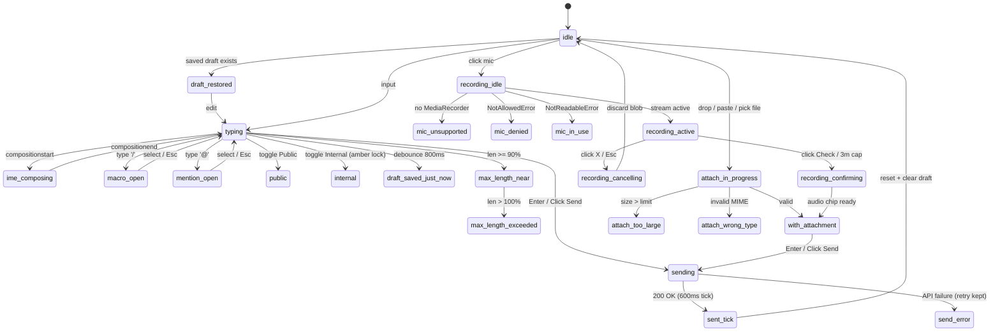

# Investor Gate OS — Design System & Stage 1 Design Brief (`docs/DESIGN.md`)

- **Project:** Investor Gate OS (IGOS) — Enterprise IT Operations Management Platform
- **Original Developer:** Moataz Qasem (2026) — governed by IGOS-DAPF
- **Branch:** `feat/ui-redesign` (UI/UX & Frontend only — zero backend, auth, API, or vault mutations)
- **Status:** Stage 1 Design Brief — **Awaiting User Approval before Stage 2 (`Phase 4A`) implementation**

---

## 1. Brand Brief (1-Page Foundation)

### Audience
- **IT Managers & Operations Leads** in Saudi and Gulf multi-company enterprises overseeing SLA compliance, technician workload, approvals, and infrastructure governance.
- **L1–L3 IT Technicians & Asset Stewards** living inside Help Desk queues, task checklists, custody handovers, and secrets references for 8+ hours every day.
- **Executives & Company Admins** reviewing high-level operational posture without chart clutter, plus **Internal Employees** opening tickets and confirming resolutions.

### Emotional & Functional Goals
- **Trust & Stewardship:** Calm institutional authority suited to financial/investment holding environments — zero gimmicks, zero visual noise.
- **Control & Speed:** Keyboard-first navigation (`⌘K`, `J/K`, `A/S/R/N`), instant visual hierarchy within 3 seconds, and predictable placement on a strict `4px` grid.
- **Calm Competence:** Warm-neutral paper canvas (`#FAF9F6`) reduces eye fatigue across long shifts; deep Petrol (`#0E5A63`) signals decisive action without shouting.
- **Openness & Clarity:** Arabic RTL is the first-class native layout; English LTR is an optically balanced mirror with metric-matched typography.

### Hard Bans (What We Strictly Avoid)
- No purple/blue-pink gradients, no glassmorphism blur cards, no glowing borders or neon accents.
- No AI branding (`المساعد الذكي`, `معالج ذكي`, "AI-powered") and zero sparkles/magic-wand icons.
- No emoji used as interface icons, no 3D blobs, no oversized `rounded-3xl` containers, no drop-shadow soup, no gradient text, no centered hero dashboards, no fake/hardcoded charts.
- No logo clichés: zero shield+lock, circuit lines, globe, bar-chart/pillars, or literal buildings.

---

## 2. Design Tokens (`frontend/src/styles/tokens.css`) & WCAG 2.2 AA Verification

Single source of truth via Tailwind v4 `@theme` + semantic CSS custom properties. Primary Petrol is reserved **exclusively** for the primary CTA, active selection, and keyboard focus. Status colors are **always** paired with an icon and text label — never color alone.

### Light Theme — Warm Paper (Default) & Dark Theme — Crafted Deep Slate Ink

| Semantic Token | Light Value | Dark Value | Role |
|---|---|---|---|
| `--bg` | `#FAF9F6` | `#111413` | Application canvas (warm paper / deep slate ink) |
| `--surface` | `#FFFFFF` | `#181C1B` | Primary cards, panes, topbar, sidebar |
| `--surface-2` | `#F4F2EE` | `#1F2423` | Subtle bands, table headers, hover fills |
| `--surface-3` | `#ECE9E3` | `#272D2C` | Disabled button fills, pressed surfaces |
| `--border` | `#E7E3DC` | `#2B3130` | Hairline 1px structural borders (`e0`) |
| `--border-strong` | `#D5D0C6` | `#3B4341` | Input borders, active dividers, resize handles |
| `--text` | `#1B1A17` | `#ECEAE4` | Primary headings & body ink |
| `--text-2` | `#5E5A52` | `#A9A59B` | Secondary labels, metadata, timestamps |
| `--text-3` | `#6E6960` *(AA text)* | `#918D84` | Readable tertiary captions (AA ≥ 4.5:1) |
| `--icon-muted` | `#8C877D` *(3:1 UI)* | `#8A867D` | Non-text muted icons, dividers, placeholders |
| `--text-disabled` | `#B8B3A8` | `#5E6462` | Disabled control text/icons |
| `--primary` | `#0E5A63` | `#4FB3BC` | Petrol primary (main CTA, selection, focus) |
| `--primary-hover` | `#0B4A52` | `#6BC4CC` | Primary hover state |
| `--primary-active` | `#083C43` | `#399DA6` | Primary pressed state |
| `--primary-soft` | `#E3F1F2` | `#173033` | Active nav pill, focus halo, selection tint |
| `--on-primary` | `#FFFFFF` | `#0A1E20` | Text/icon directly on `--primary` |
| `--accent` | `#B68F4A` | `#D8B36A` | Single warm brass accent (brand mark & rare highlight only) |
| `--success` / `-soft` / `-text` | `#2E7D4F` / `#E8F5ED` / `#21633D` | `#6AD196` / `#162A1F` / `#6AD196` | SLA OK, resolved, available |
| `--warning` / `-soft` / `-text` | `#B7791F` / `#FCF3E1` / `#8A5A0F` | `#F0B85A` / `#2E2312` / `#F0B85A` | SLA at-risk, waiting, near-capacity |
| `--danger` / `-soft` / `-text` | `#C0392B` / `#FDECEB` / `#A52D20` | `#F27C70` / `#301816` / `#F27C70` | SLA breached, overdue, recording pulse, destructive |
| `--info` / `-soft` / `-text` | `#2F6FA3` / `#E8F2FA` / `#235884` | `#6EB5EB` / `#162634` / `#6EB5EB` | Assigned, in-progress, neutral informational |
| `--internal-bg` / `-border` / `-text` | `#FFF6E5` / `#F0D9A8` / `#6E4B12` | `#282115` / `#5A4725` / `#F3D293` | Internal-note composer & timeline lock surface |

### Mathematically Verified WCAG 2.2 AA Contrast Matrix

| Pair | Light Ratio | Light Status | Dark Ratio | Dark Status |
|---|---:|---|---:|---|
| `--text` on `--bg` | **16.53:1** | PASS (AAA) | **15.40:1** | PASS (AAA) |
| `--text` on `--surface` | **17.40:1** | PASS (AAA) | **14.30:1** | PASS (AAA) |
| `--text` on `--surface-2` | **15.56:1** | PASS (AAA) | **13.08:1** | PASS (AAA) |
| `--text-2` on `--bg` | **6.52:1** | PASS (AA) | **7.54:1** | PASS (AAA) |
| `--text-2` on `--surface` | **6.86:1** | PASS (AA) | **7.00:1** | PASS (AAA) |
| `--text-3` on `--surface` | **5.32:1** | PASS (AA) | **5.20:1** | PASS (AA) |
| `--icon-muted` (`#8C877D`) on `--surface` (non-text 3:1) | **3.57:1** | PASS (UI AA) | **4.74:1** | PASS (AA) |
| `--on-primary` on `--primary` | **7.89:1** | PASS (AAA) | **6.98:1** | PASS (AA) |
| `--on-primary` on `--primary-hover` | **9.93:1** | PASS (AAA) | **8.52:1** | PASS (AAA) |
| `--primary` on `--surface` | **7.89:1** | PASS (AAA) | **6.97:1** | PASS (AA) |
| `--primary` (or `-text`) on `--primary-soft` | **6.81:1** | PASS (AA) | **6.90:1** | PASS (AA) |
| `--success-text` on `--success-soft` | **6.42:1** | PASS (AA) | **8.07:1** | PASS (AAA) |
| `--warning-text` on `--warning-soft` | **5.37:1** | PASS (AA) | **8.58:1** | PASS (AAA) |
| `--danger-text` on `--danger-soft` | **6.13:1** | PASS (AA) | **6.22:1** | PASS (AA) |
| `--info-text` on `--info-soft` | **6.61:1** | PASS (AA) | **6.96:1** | PASS (AA) |
| `--internal-text` on `--internal-bg` | **7.31:1** | PASS (AAA) | **10.96:1** | PASS (AAA) |
| `--text` on `--internal-bg` | **16.21:1** | PASS (AAA) | **13.24:1** | PASS (AAA) |

> **AA Calibration Note (logged in `docs/DECISIONS.log`):** Pure `#8C877D` on `#FFFFFF` computes to `3.57:1` — compliant for non-text UI icons (`≥ 3:1`), so it is bound to `--icon-muted`, while readable tertiary captions use `--text-3: #6E6960` (`5.32:1` on surface, `5.05:1` on bg). In Dark mode, `--on-primary` uses deep petrol ink `#0A1E20` (`6.98:1` on `#4FB3BC`) instead of white (`2.52:1`).

### Shape, Elevation, Spacing & Motion Tokens
- **Radii:** `--radius-control: 6px` (buttons, inputs, selects), `--radius-card: 10px` (cards, popovers, dropdowns), `--radius-modal: 14px` (modals, drawers, composer), `--radius-pill: 9999px` (avatars, status pills).
- **Elevation (max 3 shadows total):**
  - `e0`: `none` + `1px solid var(--border)` (default cards, tables, panels)
  - `e1`: `0 1px 2px rgba(27, 26, 23, 0.05), 0 1px 3px rgba(27, 26, 23, 0.04)` (composer, card hover)
  - `e2`: `0 6px 16px -4px rgba(27, 26, 23, 0.10), 0 2px 6px -2px rgba(27, 26, 23, 0.05)` (popovers, combobox, tooltips)
  - `e3`: `0 18px 40px -10px rgba(27, 26, 23, 0.18), 0 4px 12px -4px rgba(27, 26, 23, 0.08)` (modals, command palette)
- **Spacing:** `4px` base grid; component paddings `8px / 12px / 16px`; page gutters `24px` desktop / `16px` mobile.
- **Motion:** `--dur-fast: 120ms` (hover/press), `--dur-mid: 200ms` (popover/drawer/composer morph), `--dur-slow: 280ms` (page/panel), `--ease-out: cubic-bezier(0.2, 0.8, 0.2, 1)`. Animate **only** `opacity` and `transform`. Strictly honor `prefers-reduced-motion: reduce`. Skeletons replace spinners for all content loading.

---

## 3. Typography, Arabic RTL & Iconography Plan

### Self-Hosted Type Stack (Zero Google Fonts CDN)
- **Arabic Primary:** `IBM Plex Sans Arabic` (self-hosted WOFF2, weights `400`, `500`, `600` only, `font-display: swap`).
- **Latin Metric-Matched Partner:** `IBM Plex Sans` (self-hosted WOFF2, weights `400`, `500`, `600` only, `font-display: swap`) — shares identical x-height, cap height, and stroke contrast with `IBM Plex Sans Arabic`, eliminating vertical baseline jitter on mixed lines.
- **Monospace (identifiers/code only):** `IBM Plex Mono` / system UI monospace with `font-variant-numeric: tabular-nums lining-nums`.
- **Type Scale:** `12px` (captions/badges) · `13px` (dense table cells/secondary metadata) · `14px` (**base UI body**) · `16px` (section headings/lead) · `20px` (page titles) · `24px` (KPI values/modal titles) · `32px` (login/brand display).
- **Line-Height:** `1.6` for Arabic body prose, `1.4` for headings. Weights strictly `400 / 500 / 600` (no `300`, no heavy `700/800/900` sprawl).

### Bidi, RTL & Localization Discipline
- **Logical CSS Properties Only:** `ms-*`, `me-*`, `ps-*`, `pe-*`, `start-*`, `end-*`, `text-start`, `text-end`, `border-s-*`, `border-e-*`. Zero physical `ml-`/`mr-`/`left-`/`right-` in redesigned components.
- **Mixed Content Isolation:** User-generated content carries `dir="auto"`. Ticket IDs (`<bdi>TCK-2026-0049</bdi>`), IPs (`<bdi>10.10.1.10</bdi>`), emails, and SLA countdowns wrap in `<bdi>` with `tabular-nums`.
- **Locale & Calendar Settings:** Full Arabic/English reactive switcher in user menu; Arabic pluralization helper (zero/one/two/few/many); user preference for Gregorian vs Hijri date display and Western vs Arabic-Indic numerals (defaulting Western digits for IDs, SLA timers, and currency).

### Iconography System
- **Single Family:** `lucide-react` (already installed) standardized at **`strokeWidth={1.5}`**, `16px` (inline/controls/table) and `20px` (navigation/page headers), optically aligned.
- **RTL Mirroring:** Directional icons (`ChevronRight`, `ArrowRight`, `SendHorizontal`, `CornerDownLeft`, `LogOut`, progress indicators) wrap in a `<DirectionalIcon>` helper that flips `scaleX(-1)` in RTL while keeping non-directional symbols (`Check`, `Clock`, `Search`, `ArrowUp` send button) unmirrored.
- **6 Custom Inline Domain SVG Icons (`1.5px` stroke, `24×24` grid):** `AssetIcon`, `CustodyIcon`, `SwitchIcon`, `FirewallIcon`, `VlanIcon`, `VaultIcon` in `frontend/src/components/ui/domain-icons.tsx`.

---

## 4. Component Inventory & Architecture

### Core Typed Primitives (`frontend/src/components/ui/` — CVA + Tokens Only)
1. `Button` (`primary | secondary | ghost | danger`, `sm 32px | md 36px | lg 44px`, icon-only square, loading state)
2. `Input` & `FormField` (single-column label above, helper text, inline blur error, `dir="auto"`)
3. `Textarea` (auto-grow support, character counter)
4. `Select` (accessible native/styled select with mandatory visible or `aria-label` prop)
5. `Combobox` (searchable keyboard listbox: `↑/↓`, `Enter`, `Esc`, `aria-activedescendant`, grouped sections)
6. `Badge` / `Chip` (`neutral | primary | success | warning | danger | info`, icon + text mandatory)
7. `DataTable` (`44px` comfortable / `36px` compact toggle, sticky header, column chooser popover, saved views hook, hairline row dividers with zero zebra striping, windowing/virtualization > 200 rows, built-in empty/loading/error states)
8. `Card` (`e0` border default, `e1` interactive hover optional, disciplined `16px` padding)
9. `Tabs` (underline & pill variants, keyboard `ArrowLeft/Right` RTL-aware)
10. `SegmentedControl` (compact view switchers, e.g. List / Kanban / Calendar / Workload)
11. `Tooltip` (`e2`, 200ms delay, keyboard focusable trigger)
12. `Popover` (`e2`, collision-aware logical positioning, Esc close, focus return)
13. `Modal` & `ConfirmDialog` (`e3`, focus trap, type-entity-name confirmation for destructive actions, mobile bottom-sheet adaptation)
14. `Toast` (polite `aria-live`, 6-second Undo action support for assignments/transitions)
15. `EmptyState` (calm icon + direct Arabic/English explanation + single primary CTA)
16. `Skeleton` (quiet warm-surface shimmer respecting `prefers-reduced-motion`)
17. `Avatar` & `AvatarStack` (`full` radius, initials fallback, optional availability dot)
18. `Progress` & `CapacityBar` (thin `4px` horizontal bar, semantic color shift at 80%/100% + numeric ratio)
19. `BrandLogo` (new original Gate SVG system: symbol, horizontal lockup, stacked lockup, monochrome, 600ms loading mark)

### Signature Component 1: The Composer (Phase 4B)
Modeled on the tactile clarity of Claude/ChatGPT conversational composers with original artwork:
- **Container:** Single rounded shell (`radius 14px`), `1px solid var(--border-strong)`, `e1` shadow; focus ring = `2px var(--primary-soft)` + `border: var(--primary)`.
- **Textarea:** Auto-growing (`min 1 row`, `max ~8 rows` then internal scroll), `dir="auto"`, IME composition guard (`isComposing` / `keyCode === 229`) so Arabic/CJK composition never triggers premature send.
- **Bottom Action Row (RTL logical order, mirrored in LTR):**
  - Inline-start: Attach (`+`) button, **Public / Internal Note** segmented lock toggle.
  - Inline-end: **Record** (`32px` ghost circle, mic icon) + **Send** (`32px` circle, mirror-safe `ArrowUp` icon; disabled `--surface-3`/`--text-disabled`; enabled `--primary`/`--on-primary`, `scale(0.96)` on 120ms press; spinner → 600ms success tick).
- **Internal-Note Safety Mode:** Switches entire container to warm amber (`--internal-bg: #FFF6E5`, border `#F0D9A8`, dark `#282115`) with prominent padlock badge `"ملاحظة داخلية · Internal note"` — leaking an internal note publicly is visually unmistakable.
- **Voice Recording Morph (200ms):** Clicking Record morphs bottom row into live lightweight CSS/canvas waveform bars + `mm:ss` tabular timer + danger dot (1.2s pulse, static under `prefers-reduced-motion`) + Cancel (`×`, `Esc`) + Confirm (`✓`). Confirm attaches compact audio chip (play/pause, duration, remove). Wired to existing `POST /api/v1/tickets/voice/upload` via typed `composerVoiceAdapter` (`NEXT_PUBLIC_COMPOSER_VOICE=1`). No transcription, no AI.
- **Inline Menus & Drafts:** `/` opens Macros menu (`↑/↓/Enter`); `@` opens same-company Mentions picker; drag-over reveals attachment dropzone + paste-image; per-ticket draft autosave cleared on send/logout.

#### Composer State Machine (25 States — Verified in Phase 4B)

Full 25-state coverage checklist: `idle` · `typing` · `with-attachment` · `draft-restored` · `internal` · `public` · `macro-open` · `mention-open` · `recording-idle` · `recording-active` · `recording-cancelling` · `recording-confirming` · `sending` · `sent-tick` · `send-error` · `attach-in-progress` · `attach-too-large` · `attach-wrong-type` · `mic-denied` · `mic-unsupported` · `mic-in-use` · `ime-composing` · `draft-saved-just-now` · `max-length-near` · `max-length-exceeded`.

### Signature Component 2: Assignment & Workload (Phase 4D)
- **Assignee Combobox Popover:** Compact avatar+name chip → searchable popover with quick rows (`Assign to me [A]`, `Auto-assign`), grouped by Team, showing availability dot, `open/max` count + thin `4px` capacity bar, skill tags, and explicit disabled/override reason when at capacity.
- **Optimistic Feedback:** Instant UI update + `6s` Undo Toast (reverts via API if clicked, rolls back automatically on failure).
- **Floating Bulk Action Bar:** Appears at bottom-center when ≥ 1 item selected (`N selected · Assign… · Status… · Priority… · Clear`), fully keyboard operable.
- **Accessible Kanban:** Pointer drag + keyboard drag mode (`Focus card → Space to lift → Arrow keys to move column/order → Space to drop / Esc to cancel`) with `aria-live="assertive"` announcements.

---

## 5. Annotated Screen-by-Screen Wireframes (Arabic RTL Primary)

### A. App Shell (`248px / 64px` Collapsible Sidebar + `52px` Top Bar)
```text
+---------------------------------------------------------------+------------------------+
| [User ▾] [Bell •]        [بحث أو أمر سريع... ⌘K]  [الشركة ▾] | [Gate] بوابة المستثمر   | 52px Top Bar (--surface)
+---------------------------------------------------------------+------------------------+
|                                                               | | أعمالي           [5] | 248px Sidebar (--surface)
|  Page Title Row:  <h1>عنوان الصفحة</h1>   [+ إجراء رئيسي]     |   مكتب المساعدة   [12] | Active = primary-soft bg
|  -----------------------------------------------------------  |   المهام               | + primary text + 2px
|  Tabs / Filter Bar (Single clean horizontal row)              |   الموافقات والتغييرات  | inline-start bar
|  -----------------------------------------------------------  | ────────────────────── |
|                                                               |   الأصول التقنية        | Collapses to 64px rail
|  Main Content Region (Warm Paper #FAF9F6 canvas, 24px gutter) |   العهدة والتسليم       | (state persisted)
|  - Tables: full width, hairline rows                          |   البنية التحتية        |
|  - Reading/forms: max-w-3xl readable measure                  |   الاشتراكات           | Mobile (<1024px):
|                                                               |   خزنة الأصول الرقمية   | slide-over drawer +
|                                                               | ────────────────────── | 44px touch targets
|                                                               |   التقارير · الإعدادات  |
+---------------------------------------------------------------+------------------------+
```

### B. Help Desk 3-Region Resizable Split-Pane Inbox (`/tickets`)
```text
+--------------------+---------------------------------------+---------------------------+
| Context Side Panel | Ticket Thread + Signature Composer    | Queue List (340px)        |
| (280px, resizable) | (Fluid center, min 460px)             | [المحفوظات ▾] [تصفية] [≡] |
|                    |                                       | [ ] TCK-2026-0049  [خرق]  |
| الحالة:  [قيد المعالجة▾]| #TCK-2026-0049 · تعطل VPN الفرع  |     تعطل VPN الفرع...     |
| الأولوية: [عاجل ▾]  | [إنشاء مهمة] [دمج] [اختصارات ?]       |     أحمد · فريق الشبكات   |
| المسؤول: [أحمد (3/10)▾]| ---------------------------------- | [✓] TCK-2026-0048 [تحذير] |
| الفريق:  [الشبكات ▾]| • رد عام — موظف (10:14)              |     تحديث رخصة Firewall   |
| SLA: 00:42 متبقّي   | • [🔒 ملاحظة داخلية — فني] (#FFF6E5) | [ ] TCK-2026-0047 [سليم]  |
| المهام المرتبطة (1) | • نظام: تم التوزيع تلقائياً           |                           |
| المراقبون (2)       | +-----------------------------------+ |                           |
|                    | | اكتب رداً... (/ للردود، @ للإشارة)| |                           |
|                    | | [↑] [🎙]     [عام | 🔒 داخلي]  [+] | |                           |
|                    | +-----------------------------------+ |                           |
+--------------------+---------------------------------------+---------------------------+
                [ Floating Bulk Bar when checked: 1 محدد | تعيين… | حالة… | أولوية… | إلغاء ]
```

### C. My Work (`/my-work`), Tasks (`/tasks`), Dashboard (`/`), Login (`/login`)
- **My Work:** Single-column calm grouped feed (`متأخرة Overdue`, `اليوم Today`, `هذا الأسبوع This week`, `لاحقاً Later`) with inline quick actions (Accept, Status, Reassign, Snooze), filter tabs (`الكل | تذاكر | مهام | موافقات`), zero empty KPI void.
- **Tasks:** Segmented mode bar (`قائمة | كانبان | تقويم | عبء العمل`). List = full-width `DataTable`; Kanban = horizontal status columns with keyboard lift/drop; Workload = per-technician horizontal capacity bars with drag-to-reassign.
- **Dashboard (`/`):** Restrained executive clarity — **4 KPI tiles maximum** (live API data only, tabular numerals), 2 clean hand-authored SVG visualizations (SLA Compliance donut/bar + Team Workload horizontal bars), and compact Action Queue list.
- **Assets / Custody / Infra / Subscriptions / Vault:** Unified `DataTable` + clean single-column forms; Custody printable Arabic handover receipt polished; Vault secrets strictly masked with re-auth modal and copy-with-timeout affordance.
- **Login (`/login`):** Calm 50/50 split on Warm Paper `#FAF9F6`: quiet Petrol/Paper typographic brand panel with approved Gate lockup (zero blobs/gradients/stock imagery) + focused accessible form panel (username, password, password-manager `autocomplete`, zero exposed credentials).

---

## 6. Original Brand & SVG Logo Explorations ("Gate / Threshold")

### Concept & Rules
- **Core Idea:** An abstract geometric **Gate / Threshold (`بوابة`)** sculpted through generous negative space — representing access, order, and stewardship — with a subtle **upward/forward movement** expressing measured institutional growth (`مستثمر`).
- **Optical Discipline:** Built on a strict `32×32` coordinate grid (`4px` structural strokes, ≥ `3px` negative-space channels so it stays razor-sharp at `16px` favicon and monumental at `512px`). Works flawlessly in single-color Petrol `#0E5A63`, dark-mode `#4FB3BC`, or solid monochrome `#FFFFFF` / `#1B1A17`.
- **Wordmark Lockup:** `"بوابة المستثمر"` paired with `"INVESTOR GATE"` in optically matched `IBM Plex Sans Arabic` (SemiBold 600, tightened `-0.01em` tracking) and `IBM Plex Sans` (Medium 500, `+0.06em` tracking).

### Visual Comparison of 3 Original Hand-Authored SVG Directions
Specimen rendered in `docs/design/explorations/stage1-logo-explorations.png` (and standalone SVGs in `docs/design/explorations/`):

| Direction | Name | Construction Summary | 16px Legibility | Tone & Fit |
|---|---|---|---|---|
| **A ★ (Recommended)** | **The Rising Threshold (`العتبة الصاعدة`)** | Left curved architectural jamb + poised lintel; right pillar rises higher with a crisp beveled step; single warm-brass angled keystone floats inside the open negative-space threshold. | **Excellent** — bold 4.5px strokes and open top-end threshold stay unmistakably legible at 16px. | **Best balance** of Saudi/Gulf executive authority, architectural poise, and modern engineering precision. |
| **B** | **The Dual-Arc Portal (`البوابة المقوّسة المزدوجة`)** | Calibrated circular outer arch intentionally opened at upper-end to evoke forward momentum, nesting an inner warm-brass threshold arch. | **Good** — graceful and unmistakable at 24px–512px, slightly tighter inner channel at 16px favicon. | Warmer architectural heritage feel; slightly softer than linear operational tooling. |
| **C** | **The Monolith Aperture (`بوابة الكتلة الهندسية`)** | Squared geometric monolith opening cleanly at the base with an inset 30° rising passage bar. | **Excellent** — crisp heavy silhouette at 16px. | Ultra-minimal and industrial; slightly more utilitarian and less welcoming for executive stakeholders than A. |

### Recommendation: **Direction A — "The Rising Threshold" (`العتبة الصاعدة`)**
1. **Immediate Dual Reading:** Reads instantly as both an open **Gate (`بوابة`)** via its arched negative-space passage and **upward stewardship (`مستثمر`)** via the stepped right crown and rising keystone — with zero clichés.
2. **Unbeatable Scalability (`16px` → `512px`):** Works effortlessly in monochrome (replacing the warm-brass keystone with `currentColor`) for favicons, watermarks, printable Arabic custody receipts, and dark/light surfaces.
3. **Construction Grid & Clear-Space Rules (Locked on Approval):**
   - `viewBox="0 0 32 32"`, live artwork occupies `x: 5..27`, `y: 4..27` (`22×23` optical box centered in `32×32`).
   - **Minimum Clear Space:** `0.5×` symbol height (`16px` around a `32px` mark) on all four sides.
   - **Minimum Size:** `16px` for symbol/favicon; `24px` symbol height for horizontal bilingual lockup.
   - **Deliverables in Phase 4A upon approval:** Symbol SVG, Horizontal AR+EN lockup, Stacked lockup, Monochrome + Reversed, `favicon-16.png` / `favicon-32.png` / `favicon.svg`, maskable PWA app icon (`safe-zone` 80% centered), and subtle `600ms` reduced-motion-safe loading mark animation.

---

## 7. Engineering Constraints, Dependencies & Feature Flags

- **Bundle Budget:** Initial App Shell JS strictly **< 150 KB gzip** (verified via `next build` bundle metrics in Phase 4C).
- **Minimal New Dependencies (Justification per Ambiguity Protocol):**
  - `class-variance-authority` (~1.1 KB gzip) for strictly typed variant styling in `frontend/src/components/ui/`.
  - Lightweight headless a11y primitives (`@radix-ui/react-dialog`, `@radix-ui/react-popover`, `@radix-ui/react-tooltip`, `@radix-ui/react-tabs`) only where focus-trapping/ARIA positioning prevents brittle custom code; total added runtime gzip stays well under 15 KB.
  - Self-hosted WOFF2 fonts (`IBM Plex Sans Arabic` + `IBM Plex Sans`, weights `400/500/600`) — zero runtime JS, zero third-party CDN, 100% nginx CSP compatible.
- **Feature Flags & Backend-Gap Adapters (Zero Backend Changes on `feat/ui-redesign`):**
  - `NEXT_PUBLIC_DESIGN_LAB=1` — exposes dev-only `/design` System Lab route (hidden/404 when unset/0).
  - `NEXT_PUBLIC_DEV_TOOLKIT=1` — opt-in developer HUD overlay (default OFF so production chrome is never occluded).
  - `NEXT_PUBLIC_COMPOSER_VOICE=1` — enables Composer MediaRecorder voice clips wired to existing `POST /api/v1/tickets/voice/upload` via `composerVoiceAdapter`.
  - `NEXT_PUBLIC_COMPOSER_ATTACHMENTS=1` — enables typed `composerAttachmentAdapter` for non-audio reply files (graceful capability notice if backend endpoint is absent; documented in `docs/DECISIONS.log`).
  - `NEXT_PUBLIC_MYWORK_SNOOZE=1` — enables client-session snooze adapter on `/my-work` until a persistent backend snooze field is prioritized.
