# Investor Gate OS 3.0 — Enterprise Architecture, ERD & 15 System Diagrams

## 1. Overall System Architecture (Modular Monolith)

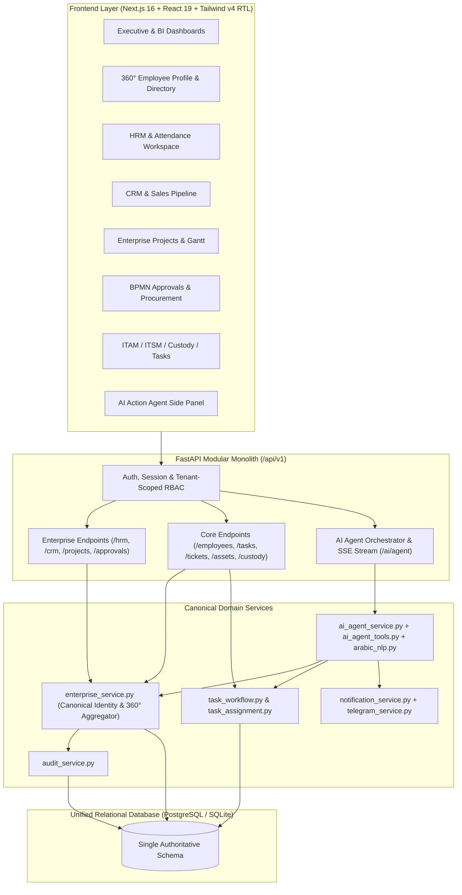

---

## 2. Unified Enterprise Database ERD

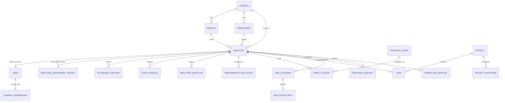

---

## 3. Company & Branch Hierarchy

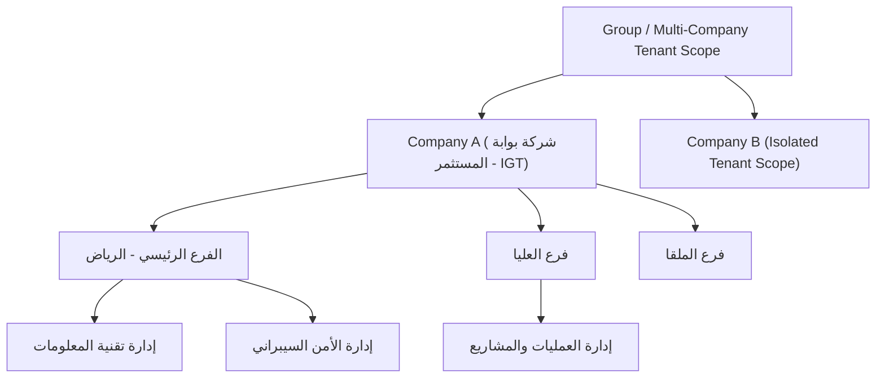

---

## 4. Canonical Employee Relationships (One Identity Everywhere)

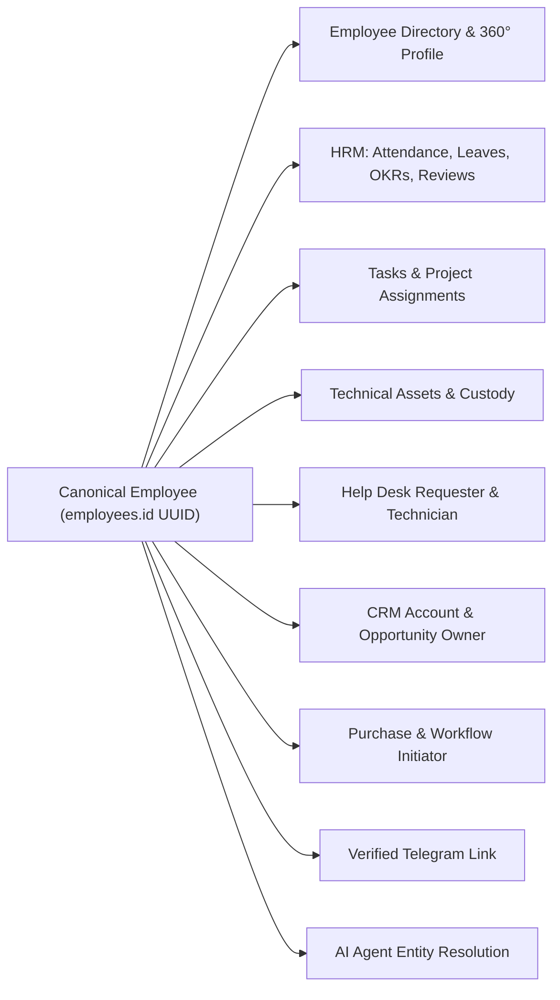

---

## 5. RBAC & Resource-Level Permission Architecture

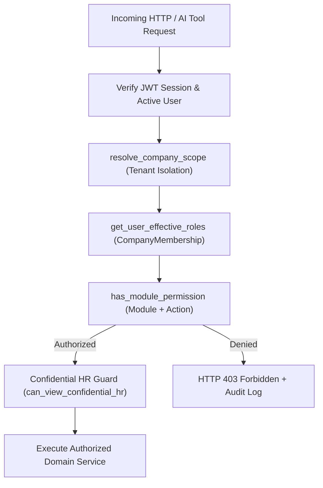

---

## 6. CRM Opportunity Lifecycle

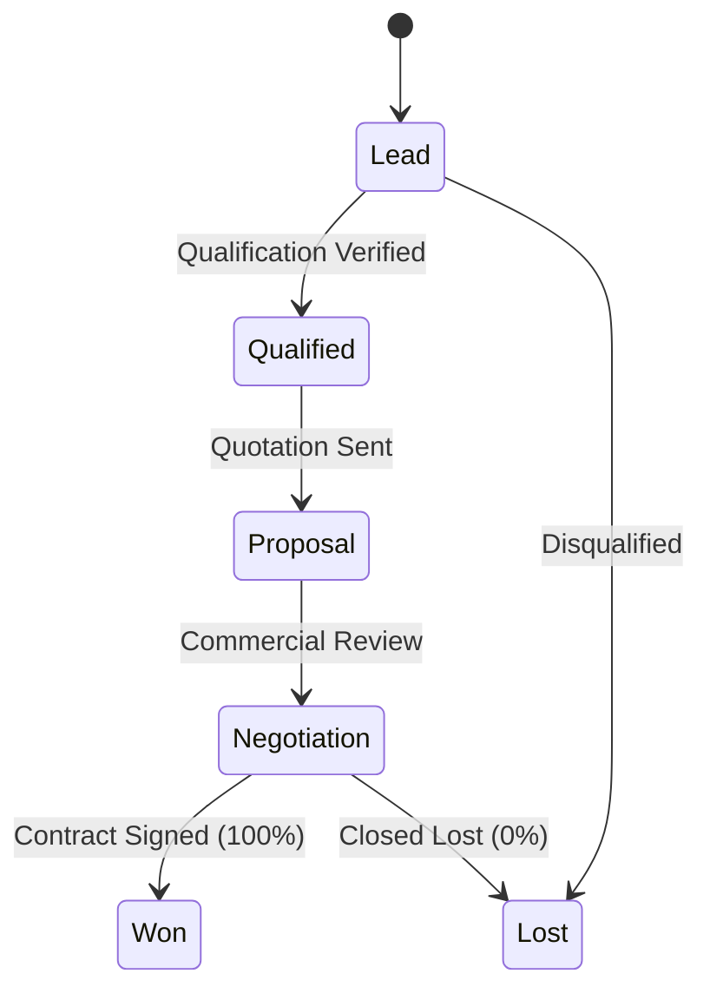

---

## 7. Technical Asset & Custody Lifecycle

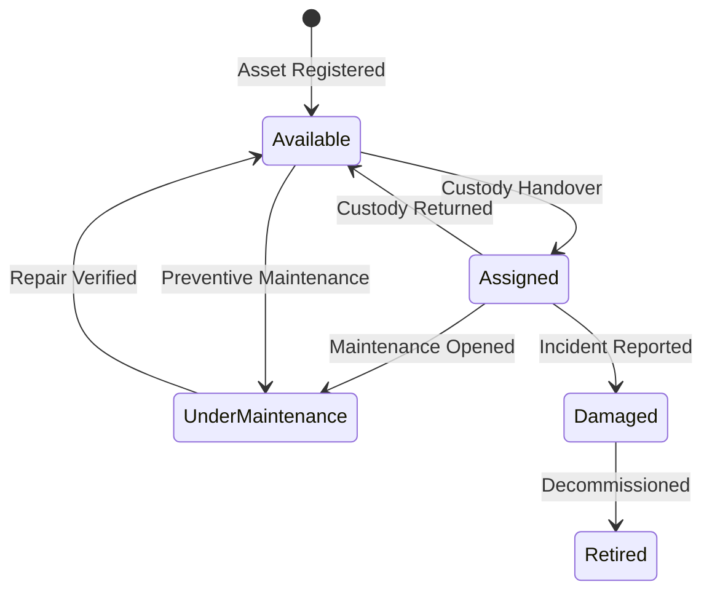

---

## 8. Attendance & Leave Data Flow

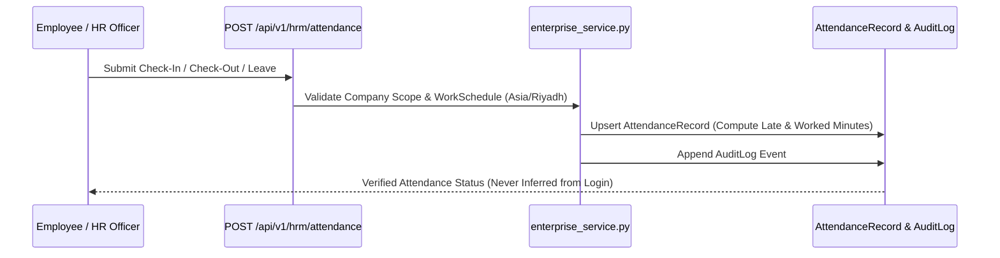

---

## 9. Task Assignment & Telegram Synchronization Workflow

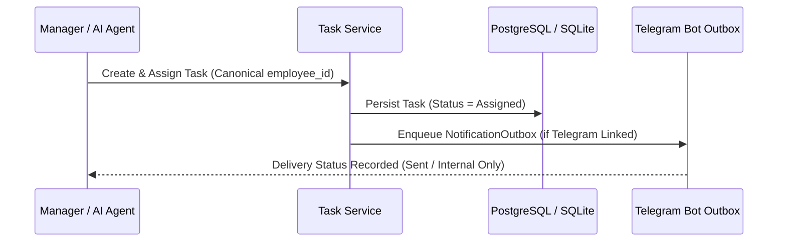

---

## 10. Help Desk Ticket Escalation Workflow

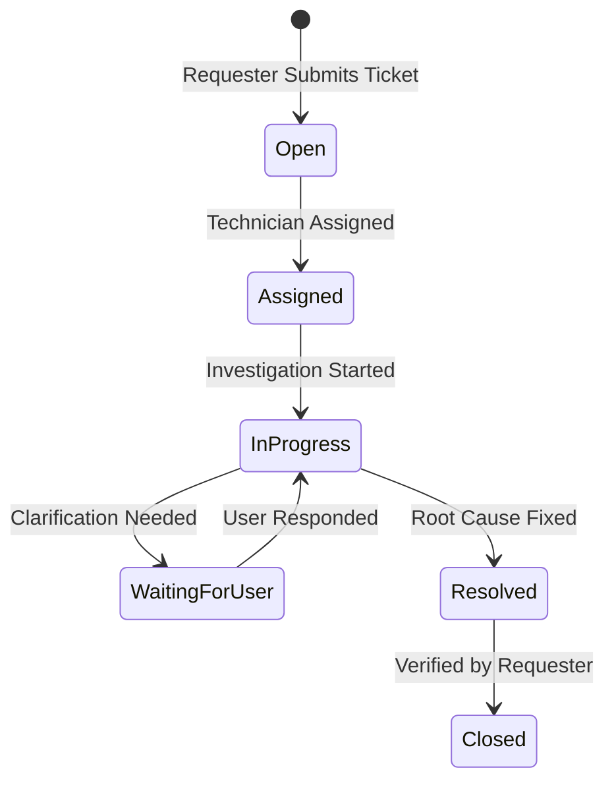

---

## 11. Purchase Request & Unified BPMN Approval Workflow

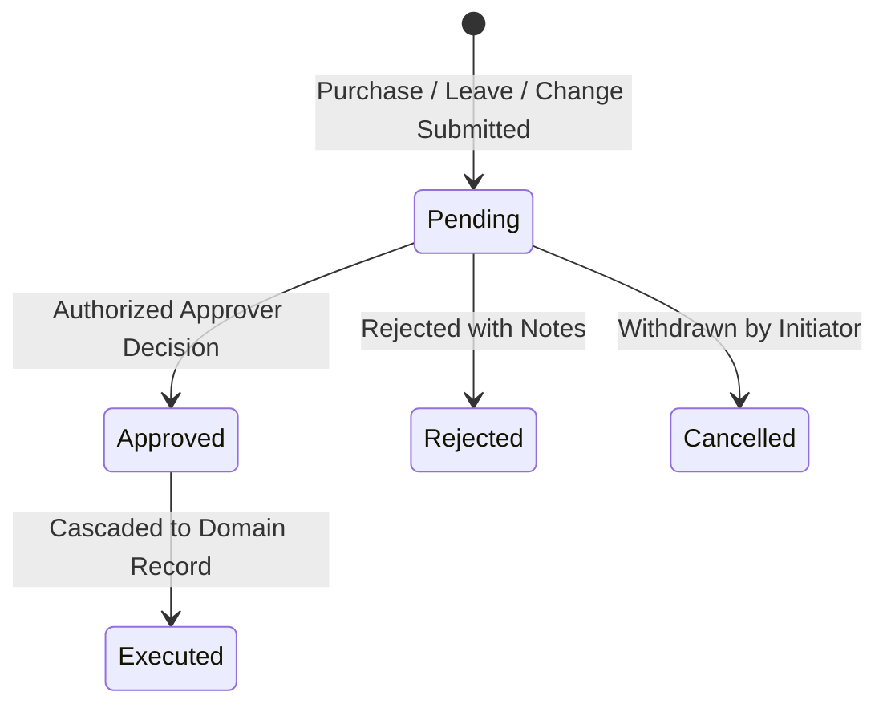

---

## 12. AI Action Agent Execution Lifecycle

```mermaid
flowchart LR
    U["1. Understand (Arabic/Dialect/English)"] --> R["2. Retrieve Context"]
    R --> E["3. Resolve Canonical UUIDs"]
    E --> P["4. Plan Tool Execution"]
    P --> V["5. Validate RBAC & Tenant Scope"]
    V --> Pr["6. Preview Dry-Run Card"]
    Pr --> C["7. Explicit User Confirmation"]
    C --> Ex["8. Execute Domain Transaction"]
    Ex --> Ve["9. Verify & Audit"]
```

---

## 13. Cross-Module Enterprise Integrations

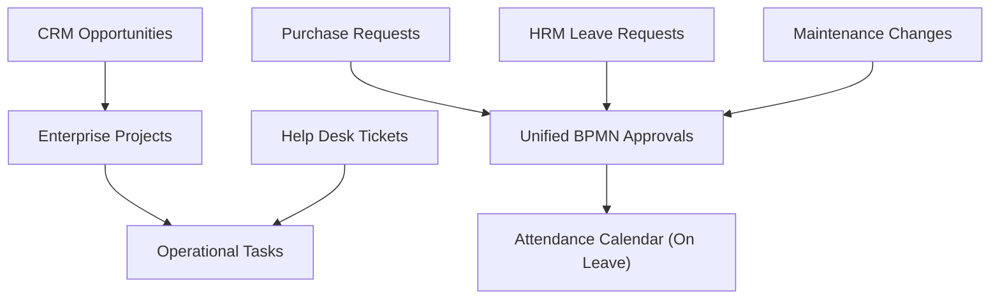

---

## 14. Self-Hosted Deployment Architecture

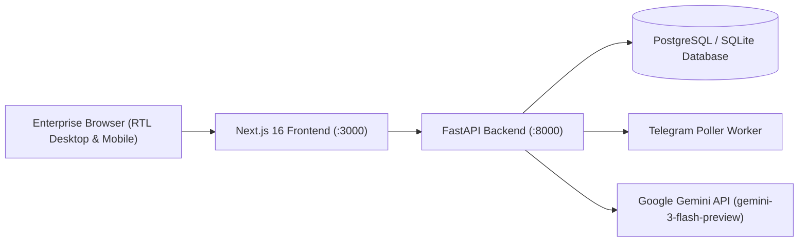

---

## 15. Non-Destructive Database Migration Flow

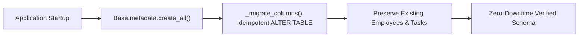
