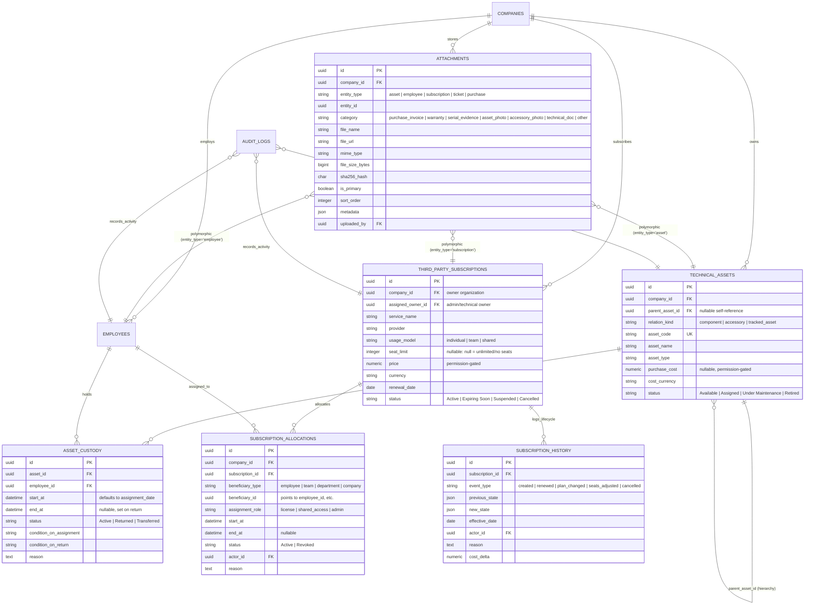

<!--
==============================================================================
Investor Gate OS (IGOS) - Technical Operations Platform
Original Developer: Moataz Qasem (2026)
Attribution Framework: IGOS Developer Attribution & Provenance Framework (IGOS-DAPF)
==============================================================================
-->

# Investor Gate OS — Implementation Map
**Phase 0: Architecture & Dependency Investigation**  
**Date:** 2026-11-22  
**Framework:** IGOS Developer Attribution & Provenance Framework (IGOS-DAPF)  
**Original Developer:** Moataz Qasem (2026)

---

## 1. Verified Inventory of Existing Modules

| Module / Area | Backend Model & Table | API Router & Endpoints | Frontend View & Route | Navigation Status | Verification |
| :--- | :--- | :--- | :--- | :--- | :--- |
| **Employees** | `Employee` (`employees`), `EmployeeDocument` (`employee_documents`), `EmployeeAssignmentHistory` (`employee_assignment_history`) in `backend/app/models/user.py` & `enterprise.py` | `endpoints/employees.py`: `GET /`, `POST /`, `GET /{id}`, `PUT /{id}`, `DELETE /{id}`, `GET /{id}/profile360`, `POST /quick` | `frontend/src/app/employees/page.tsx` (Employee 360 workspace, tabs for overview, tasks, attendance, assets, tickets) | Present in `Sidebar.tsx` (`/employees`) | `[VERIFIED]` |
| **Technical Assets** | `TechnicalAsset` (`technical_assets`) in `backend/app/models/asset.py` | `endpoints/assets.py`: `GET /`, `POST /`, `GET /{id}`, `PUT /{id}`, `DELETE /{id}`, `GET /summary`, `POST /qr-scan` | `frontend/src/app/assets/page.tsx` (Asset grid/table, status filters, create/edit modals) | Present in `Sidebar.tsx` (`/assets`) | `[VERIFIED]` |
| **Asset Custody** | `AssetCustody` (`asset_custody`) in `backend/app/models/asset.py` | `endpoints/assets.py`: `GET /custody/active`, `POST /custody/assign`, `POST /custody/return` | `frontend/src/app/custody/page.tsx` (Custody logs, delivery & return forms) | Present in `TopNav.tsx` and `MobileMoreMenuSheet.tsx`; not in desktop `Sidebar.tsx` | `[VERIFIED]` |
| **Subscriptions** | `ThirdPartySubscription` (`third_party_subscriptions`), `EmployeeSubscription` (`employee_subscriptions`) in `backend/app/models/subscription.py` | `endpoints/subscriptions.py`: `GET /`, `GET /summary`, `POST /`, `GET /{id}`, `PUT /{id}`, `DELETE /{id}`, `GET /{id}/employees`, `POST /{id}/employees`, `DELETE /{id}/employees/{emp_id}` | `frontend/src/app/subscriptions/page.tsx` (Full dashboard, KPI cards, table, renewal calendar, seat allocation modal) | **Missing from `Sidebar.tsx`** (present in `TopNav.tsx` quick links and `MobileMoreMenuSheet.tsx`) | `[VERIFIED]` |

---

## 2. Subscription Data & Backend Recovery Status

* **Database State (`it_ops.db`):** `[VERIFIED: 100% RECOVERABLE & PRESENT]`
  * Table `third_party_subscriptions` contains **49 active records** spanning SaaS providers (Microsoft 365, Google Workspace, Adobe Creative Cloud, Zoom, Slack, Jira, AWS, etc.).
  * Table `employee_subscriptions` exists and is structurally intact (currently 0 allocated seat rows).
* **Backend State:** `[VERIFIED]`
  * Models `ThirdPartySubscription` and `EmployeeSubscription` are registered in `backend/app/models/__init__.py`.
  * The dedicated router `subscriptions.py` (590 lines) is registered in `backend/app/api/v1/router.py:39` under tag `Third-Party Subscriptions`.
* **Frontend State:** `[VERIFIED]`
  * `frontend/src/app/subscriptions/page.tsx` (53 KB) is fully implemented with stats cards, search, status filters, and allocation dialogs.
* **Root Cause of Apparent Disappearance:** `[VERIFIED]`
  * The route `/subscriptions` was omitted from `navItems` in `frontend/src/components/layout/Sidebar.tsx` during prior sidebar consolidation, hiding it from the desktop primary navigation while the underlying system remained intact.

---

## 3. Supporting Infrastructure Audit

* **File Attachments & Uploads:** `[VERIFIED: PARTIAL / FRAGMENTED]`
  * Existing tables: `employee_documents` (for employees), `ticket_attachments` (for service desk). Custody has a single `attachment VARCHAR(512)` path column. Technical assets have no attachment table.
  * Gap: No unified polymorphic attachment model. No centralized content-sniffing MIME check, per-tenant SHA-256 deduplication, or client-side downscale pipeline.
* **Audit Logging:** `[VERIFIED: COMPLETE & CENTRALIZED]`
  * `AuditLog` table in `backend/app/models/audit.py`. Standardized helper `app.services.audit_service.log_audit` writes user, company, action, resource type, IP, and details.
  * Direction: All new transitions (custody assign/return, subscription seat allocation/reassignment/renewal) will reuse `AuditLog`. Zero competing audit tables will be created.
* **Permissions & RBAC:** `[VERIFIED: PARTIAL]`
  * Matrix in `backend/app/core/rbac.py` enforces module-level access (`assets`, `custody`, `subscriptions`, `employees`) across roles.
  * Gap: Lacks explicit financial/cost permission (`can_view_cost`) to selectively mask `price`, `currency`, and `purchase_cost` from non-privileged roles across endpoints and frontend views.
* **Notifications & Reminders:** `[VERIFIED: COMPLETE]`
  * Models `Notification` and `NotificationOutbox` in `backend/app/models/notification.py` with multi-channel dispatch (in-app, Telegram).
  * Direction: Subscription expiry and warranty alerts (30/60/90 days) can directly feed `NotificationOutbox`.
* **Scheduler & Background Workers:** `[VERIFIED: LEAN / ZERO DEPENDENCY]`
  * Uses lightweight worker architecture (`backend/app/workers/telegram_poller.py` with lockfiles). No Celery or APScheduler dependencies installed.
  * Direction: Retain zero-dependency policy; renewal sanity evaluations execute on-demand or during scheduled worker passes.
* **Dashboard Widget System:** `[VERIFIED: MODULAR]`
  * Endpoint `GET /api/v1/dashboard` in `backend/app/api/v1/endpoints/dashboard.py` aggregates data for `frontend/src/app/page.tsx`.
  * Gap: Subscription metrics in `/dashboard` are basic totals; needs enriched widgets (upcoming renewals, seats assigned/available, provider breakdown).
* **Vendor, Purchasing & Approvals:** `[VERIFIED: COMPLETE]`
  * `PurchaseRequest` and `WorkflowApproval` exist in `backend/app/models/enterprise.py`. `TicketApproval` exists in `backend/app/models/ticket.py`.

---

## 4. Implementation Gap Matrix

| Area / Feature | Current Repository State | Target Design (Phase 1-3) | Classification | Action Required |
| :--- | :--- | :--- | :--- | :--- |
| **Unified Attachments** | Fragmented per module (`employee_documents`, `ticket_attachments`, string paths) | Single polymorphic `attachments` table (`entity_type`, `entity_id`, `category`, `metadata`, `sha256`) | `[VERIFIED: NEEDS CHANGE]` | Create single model + migration; deprecate ad-hoc attachment fields cleanly. |
| **Asset Hierarchy** | Flat model without parent/child or accessory distinction | Add `parent_asset_id` (self-FK) + `relation_kind` (`component`, `accessory`, `tracked_asset`) | `[VERIFIED: NEEDS CHANGE]` | Additive migration to `technical_assets`; inline accessory UI in asset form. |
| **Custody Concurrency** | Application-level validation only | Database constraint: partial unique index (`asset_id` WHERE `status = 'Active'`) | `[VERIFIED: NEEDS CHANGE]` | Reversible additive migration with partial index; prevents double-assignment. |
| **Subscription Usage Models** | Hardcoded SaaS type; fixed non-nullable `seat_limit` | Nullable `seat_limit`; add `usage_model` (`individual`, `team`, `shared`) | `[VERIFIED: NEEDS CHANGE]` | Additive columns to `third_party_subscriptions`; support no-seat vs seat-based models. |
| **Subscription Beneficiaries** | `employee_subscriptions` links only to `employee_id` | Polymorphic beneficiary: `beneficiary_type` (`employee`, `team`, `department`, `company`), `start_at`, `end_at` | `[VERIFIED: NEEDS CHANGE]` | Expand allocation schema with temporal fields and row-level locking on allocation. |
| **Subscription Renewal History** | Single `renewal_date` field; updates overwrite past state | `subscription_history` table tracking state transitions, renewals, plan changes, actors | `[VERIFIED: MISSING]` | Add lightweight history table (1 table, within budget $\le 8$). |
| **Cost Permission Masking** | Costs visible to anyone with module view access | Server-side masking of `price`/`cost` fields unless user possesses `finance:view_cost` | `[VERIFIED: NEEDS CHANGE]` | Add `can_view_cost` helper in RBAC; filter Pydantic response payloads. |
| **Main Navigation** | `/subscriptions` omitted from `Sidebar.tsx` | Restore `/subscriptions` into `navItems` in `Sidebar.tsx` | `[VERIFIED: NEEDS CHANGE]` | Add item to navigation array with proper icon and translation. |
| **Employee 360 Integration** | Shows tasks, attendance, assets, tickets, documents; no subscriptions | Add "الاشتراكات والتراخيص" tab displaying direct licenses vs shared team access | `[VERIFIED: NEEDS CHANGE]` | Extend `get_employee_360_profile` and frontend tab renderer. |
| **Dashboard Widgets** | Basic count of active subscriptions and monthly total | Add seats allocated/available, 30/60/90-day renewal alerts, provider distribution | `[VERIFIED: NEEDS CHANGE]` | Enhance `/dashboard` response and add widget cards in `frontend/src/app/page.tsx`. |

---
**Status:** Phase 0 complete. All claims verified against source code and SQLite database.  
**STOP: Awaiting user approval to proceed to Phase 1 (Design + Plan).**

---

## 5. Phase 1: Architecture, ER Design & Implementation Plan

---

## 6. Entity Budget & Justification (Budget: $\le 8$ New Tables)

Total new tables introduced: **3** (strictly meets the budget $\le 8$). All counts and seats are computed dynamically.

| Entity | Action | Justification & Architectural Rule |
| :--- | :--- | :--- |
| **`attachments`** | **NEW TABLE (1/8)** | Unified polymorphic file registry replacing fragmented `employee_documents` and ad-hoc string path columns. Supports categorization (`purchase_invoice`, `warranty`, `serial_evidence`, `asset_photo`, etc.), tenant SHA-256 deduplication, and lazy signed URLs. |
| **`subscription_allocations`** | **NEW TABLE (2/8)** | Replaces the restrictive 1:1 `employee_subscriptions`. Supports multi-type beneficiaries (`employee`, `team`, `department`, `company`), clearly differentiates direct `license` from `shared_access`, and enforces temporal history (`start_at`, `end_at`). |
| **`subscription_history`** | **NEW TABLE (3/8)** | Immutable audit and renewal ledger. Overcomes the limitation of single overwriting `renewal_date` and `price` columns, preserving historical renewal dates, tier changes, and financial deltas. |
| **`technical_assets`** | **MODIFY (Additive)** | Adds `parent_asset_id` (self-referencing FK) and `relation_kind` (`component`, `accessory`, `tracked_asset`) to support nested hardware hierarchies and accessory promotion. Adds `purchase_cost` and `cost_currency` with strict server-side masking. |
| **`asset_custody`** | **MODIFY (Additive)** | Adds `start_at`, `end_at`, and `reason`. Adds partial unique index `uq_active_asset_custody (asset_id WHERE status = 'Active')` to guarantee single-custody at the database engine level. |
| **`third_party_subscriptions`** | **MODIFY (Additive)** | Makes `seat_limit` nullable (supporting non-seat/unlimited plans) and adds `usage_model` (`individual`, `team`, `shared`). |
| **`audit_logs`** | **REUSE (Zero Change)** | Reused directly for all lifecycle events (`asset.*`, `custody.*`, `subscription.*`). Zero competing audit tables created. |
| **`Computed Metrics`** | **NO TABLE (Compute)** | Available seats (`seat_limit - count(active_licenses)`), active beneficiaries, upcoming renewals, and total expenditure are computed via optimized indexed queries; never stored as denormalized driftable columns. |

---

## 7. Reversible, Data-Preserving Migration Plan

1. **Step 1: Additive Columns to Existing Tables (Non-Destructive)**
   - `technical_assets`: Add `parent_asset_id` (`UUID`, NULL, FK -> `technical_assets.id` ON DELETE SET NULL), `relation_kind` (`VARCHAR(30)` default `'tracked_asset'`), `purchase_cost` (`NUMERIC(12,2)` NULL), `cost_currency` (`VARCHAR(10)` default `'SAR'`).
   - `asset_custody`: Add `start_at` (`DATETIME`), `end_at` (`DATETIME` NULL), `reason` (`TEXT` NULL). Backfill `start_at = assignment_date`, `end_at = actual_return_date`.
   - `third_party_subscriptions`: Alter `seat_limit` to allow `NULL`; add `usage_model` (`VARCHAR(30)` default `'individual'`).
2. **Step 2: Create Partial Unique Indexes for Concurrency & Data Integrity**
   - Postgres / SQLite: Create unique partial index on `asset_custody(asset_id)` WHERE `status = 'Active'`.
   - Create unique partial index on `subscription_allocations(subscription_id, beneficiary_type, beneficiary_id)` WHERE `status = 'Active' AND assignment_role = 'license'`.
3. **Step 3: Create New Tables**
   - Create `attachments` with composite index on `(entity_type, entity_id)` and tenant hash index on `(company_id, sha256_hash)`.
   - Create `subscription_allocations` and `subscription_history`.
4. **Step 4: Data-Preserving Seed / Migration**
   - If historical records exist in `employee_subscriptions`, copy them into `subscription_allocations` with `beneficiary_type='employee'`, `assignment_role='license'`, `status='Active'`.
   - Existing 49 rows in `third_party_subscriptions` remain untouched and functional.
5. **Rollback (Downgrade) Strategy:**
   - Drops only the 3 new tables and created partial indexes.
   - Preserves all historical asset and subscription data intact.

---

## 8. API Specification & Permission Matrix

### 8.1 API Endpoints
* **Attachments:**
  * `POST /api/v1/attachments/upload`: Multipart upload with content-sniffed MIME check, SHA-256 dedupe, category tagging.
  * `GET /api/v1/attachments/{entity_type}/{entity_id}`: Returns authorized attachments with temporary signed URLs.
  * `DELETE /api/v1/attachments/{id}`: Soft-delete/unlink attachment.
* **Assets & Hierarchy:**
  * `GET /api/v1/assets/{id}/hierarchy`: Returns parent asset, nested components, and attached accessories without N+1 queries.
  * `POST /api/v1/assets/{id}/accessories`: Inline accessory addition (creates child record).
  * `POST /api/v1/assets/{id}/promote`: Promotes an accessory to an independent tracked asset.
  * `POST /api/v1/assets/{id}/custody/transfer`: Atomic close of previous active custody + creation of new active custody in a single transaction.
* **Subscriptions & Allocations:**
  * `GET /api/v1/subscriptions/{id}/details`: Returns owner, plan, dynamic seat stats (`total`, `allocated`, `available`), beneficiaries, renewal history.
  * `POST /api/v1/subscriptions/{id}/allocate`: Allocates seat/access. Uses `SELECT ... FOR UPDATE` row lock on `third_party_subscriptions` to prevent race conditions and over-allocation.
  * `POST /api/v1/subscriptions/{id}/reassign`: Atomically revokes old beneficiary and creates new beneficiary allocation.
  * `POST /api/v1/subscriptions/{id}/renew`: Logs renewal in `subscription_history` and updates `renewal_date`.
* **Employee 360 Extension:**
  * `GET /api/v1/employees/{id}/profile360`: Enriched with `subscriptions` section (distinguishing dedicated individual licenses from shared departmental tools).

### 8.2 Permission Matrix & Financial Masking
* **Cost Permission Rule:** Only users with `Action.VIEW_COST` / `Role: Super Admin | Company Admin` receive `purchase_cost`, `price`, and aggregated cost analytics. For all other roles, cost fields serialize as `null` or omitted server-side.
* **RBAC Breakdown:**
  * **Super Admin / Company Admin:** Full access (CRUD, assign, allocate, view costs, approve).
  * **IT Manager:** Full operational management (assets, custody, subscriptions, allocations, accessories); cost visible if granted financial view.
  * **Department Manager:** Read-only access to department assets and assigned subscriptions; can request transfers.
  * **Standard Employee:** Read-only access to self-assigned custody and self-allocated licenses in Employee 360. Zero financial data visible.

---
**Status:** Phase 1 Design + Plan complete.  
**STOP: Awaiting user approval to proceed to Phase 2 (Backend Execution: Migrations, Models, Services & Tests).**
