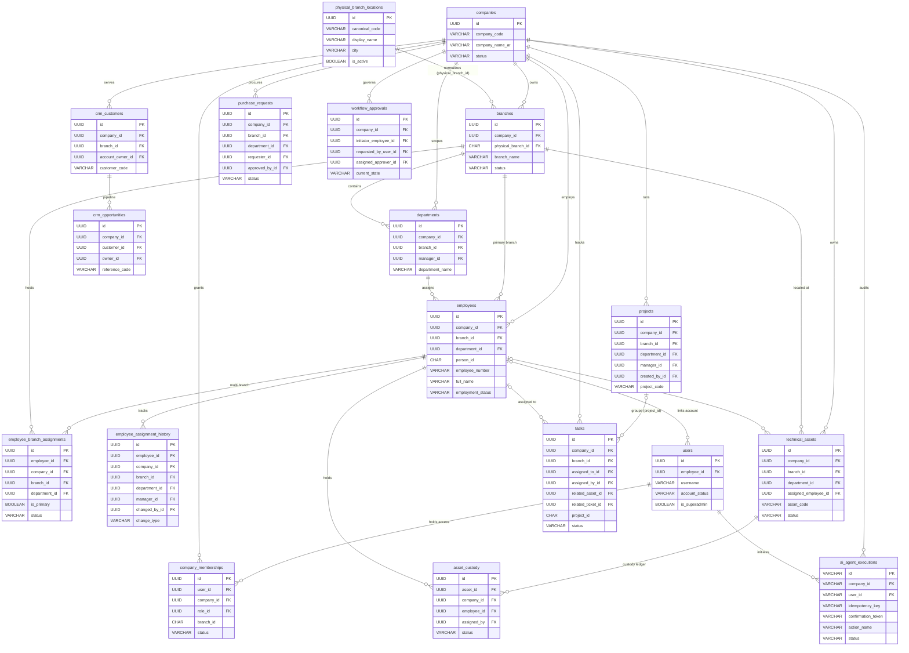

# Investor Gate OS 3.0 — Enterprise Audit, Refactoring & Deep QA Acceptance Report

**Branch:** `audit/enterprise-v3-qa` (branched from `master` commit `1e4c96b`)  
**Repository:** `https://github.com/MOATAZQ24/new`  
**Audit Date:** 2026-11-18  
**Production Database Safety Check:** Verified `c:\Users\Acodet\Desktop\new\it_ops.db` remained **completely unmodified** (`5,263,360` bytes, `LastWriteTime: 2026-11-18 00:11:41.596489`, live `alembic_version = 20261117_ai_agent_exec`). All schema migration, API, benchmark, and browser E2E checks executed exclusively against disposable clones and isolated test databases.

---

## 1. Executive Acceptance Matrix

| Domain | Status | Evidence & Verification Scope |
|---|---|---|
| **A. Schema, Alembic Migration & Data Integrity (Clone)** | `PASS` | `alembic upgrade head` -> `20261117_enterprise_v3` on disposable production clone (`54` tables, `5` `physical_branch_locations`, `0` active non-canonical branches, `0` missing `physical_branch_id`, `0` null `person_id`, `0` orphan FKs) |
| **B. Canonical 5-Branch Governance** | `PASS` | Canonical physical branch reconciliation verified in clone & API security/audit tests (`test_p0_idor_canonical_protection_workflows_and_dashboard_reconciliation`) |
| **C. Multi-Company & Multi-Branch Identity (Scenarios A–F)** | `PASS` | Verified in `test_scenarios_a_b_c_d_e_f_and_atomic_onboarding` + live `/employees` & Employee 360° browser verification (`final_step_94.png`) |
| **D. RBAC, Tenant Isolation & IDOR Hardening** | `PASS` | Fixed P0 `authorize_company` argument order across `companies.py` (6 endpoints), `update_employee` location ordering in `employees.py`, FK company scoping, active membership checks, and lockout `timedelta`; `28` security regression + `8` P1 regression + deep audit tests pass |
| **E. Procurement, Custody & Help Desk Workflows** | `PASS` | Atomic rollback on onboarding/bulk import/custody errors, `provision-asset` procurement flow, and Help Desk ticket reopen clearing `resolved_at`/`closed_at` verified |
| **F. Dashboard KPI & Chart Reconciliation** | `PASS` | Dashboard overview & charts reconciled (`test_p0_idor_canonical_protection_workflows_and_dashboard_reconciliation`) + P95 clone latency `229.43ms` |
| **G. AI Action Agent Intelligence & Safety Guardrails** | `PASS` | Fixed Arabic verb/preposition/conjunction parsing (`اسند ... إلى ...`, `ومراجعة الشبكة`), negative confirmation cancellation guardrail (` ألغِ العملية السابقة قبل تأكيدها`), ordinal candidate recovery, `pending_confirmation.preview`; `103` scenarios (`19.02ms/turn`, `100% PASS`) + 14-prompt & adversarial suite |
| **H. Frontend TypeScript, ESLint & Visual/RTL/Responsive QA** | `PASS` | `npx tsc --noEmit && npm run lint` exited `0` (`0` errors, `35` non-blocking warnings); CSS `--on-primary` button contrast, Sidebar truncation, TopNav `Ctrl+K` spacing, `1023px` tablet drawer breakpoint, Company code badge wrap, Employee 360° header & branches fixed and re-verified in live Chromium |
| **I. Seed Data Hygiene & Cleanups** | `PARTIAL` | Cloned legacy dataset retains duplicate sample department names (`قسم الدعم والعمليات التجريبي`) on `/companies` and an unlinked legacy asset (`AST-BOT-B70411`, `status='Assigned'`, `assigned_employee_id=NULL`). UI now displays `"عهدة غير محددة الموظف"` instead of misleading `"في المستودع"` |
| **J. Live PostgreSQL Runtime Migration & Container Stack** | `BLOCKED` | **External Blocker (`DOCKER_BLOCKED`)**: Docker Desktop Linux engine and local `psql` CLI are unavailable in this environment |
| **K. GitHub Draft Pull Request Creation** | `BLOCKED` | **External Blocker (`GH_BLOCKED`)**: `gh` CLI is unauthenticated in this environment |

---

## 2. Core Enterprise Entity-Relationship Architecture

Verified directly via `PRAGMA table_info` and `PRAGMA foreign_key_list` on the migrated `20261117_enterprise_v3` disposable clone (`54` tables; showing the 18 audited core entities and relationships):



---

## 3. Audit Findings & Resolved Root Causes

### 3.1 Backend & Security Defects Fixed
1. **P0 `authorize_company` Argument Inversion (`backend/app/api/v1/endpoints/companies.py`)**
   - **Root Cause:** Six branch/department CRUD handlers (lines `312, 347, 365, 388, 427, 454`) passed `authorize_company(current_user, ..., db)` instead of `authorize_company(db, current_user, ...)`, raising `500 AttributeError: 'User' object has no attribute 'get'`.
   - **Resolution:** Fixed parameter order across all 6 call sites; verified in `test_p0_idor_canonical_protection_workflows_and_dashboard_reconciliation`.
2. **Branch-Bound Department Update Validation Bypass (`backend/app/api/v1/endpoints/employees.py`)**
   - **Root Cause:** `update_employee` (lines `441-455`) invoked `validate_employee_location` against stale `emp.branch_id` before applying `payload.branch_ids[0]`, allowing mismatched branch/department assignments.
   - **Resolution:** Computed `effective_branch_id = payload.branch_id or (payload.branch_ids[0] if payload.branch_ids else emp.branch_id)` prior to validation; verified HTTP `400` rejection on cross-branch department updates.
3. **Company Membership, Lockout & Cross-Tenant FK Hardening (`security.py`, `auth.py`, `users.py`, endpoints)**
   - Enforced `Active` membership scoping, `validate_company_fk` across tenant-owned resources, `timedelta` lockout expiration checks, atomic onboarding/bulk import rollback, Help Desk reopen clearing `resolved_at`/`closed_at`, Procurement `provision-asset`, and `project_id` emission on `POST /api/v1/tasks` (`tasks.py` line `317`).
4. **Database Schema & Alembic Migration (`backend/alembic/versions/20261117_enterprise_v3.py`, `enterprise_service.py`)**
   - Added canonical 5-branch reconciliation (`physical_branch_locations`), `branches.physical_branch_id`, `employees.person_id`, `tasks.project_id`, and enterprise HR/CRM/Project/Procurement tables cleanly without mutating live production `it_ops.db`.

### 3.2 AI Action Agent Defects Fixed (`backend/app/services/ai_agent_service.py`)
1. **Arabic Command Verb & Preposition Extraction (Lines `265, 307, 462, 658`)**
   - Added single-task assignment verbs (`اسند|أسند|إسناد|كلف|كلّف|وج[ّ]?ه`) and prioritized `إلى\s+` before `الى\s+` so commands like `"اسند مهمة فحص النسخ الاحتياطي إلى أحمد"` cleanly resolve to `create_task` + candidate disambiguation (`needs_clarification`).
2. **Arabic Comma-List Conjunction Prefix Bug (Lines `436-441`)**
   - Replaced naive stripping with `seg = re.sub(r"^(?:و\s+|و(?=[أإآاتمفصنحعسركجطشض]|ال))", "", seg)` to clean `"ومراجعة الشبكة"` -> `"مراجعة الشبكة"` while preserving `و`-root words (`ويندوز`, `وورد`, `وصول`).
3. **P0 Confirmation Safety Guardrail Bypass (Lines `1551-1601`)**
   - **Root Cause:** Sending a negative utterance (`"ألغِ العملية السابقة قبل تأكيدها."`) alongside an open `confirmation_token` without explicit `confirm_decision` fell through and executed instead of cancelling.
   - **Resolution:** Automatically infers `conf_decision = "cancel"` on negative replies and permits `conf_decision = "confirm"` only on affirmative/empty confirmation payloads; attaches `"preview": conf.get("args", tool_args)` inside `pending_confirmation`.
4. **Ambiguous Ordinal Follow-up Memory Loss (Lines `1699-1727`, `1858-1884`)**
   - Preserved `candidates` in `pending_intent` and recovered from `AIAgentExecution.status.in_(["needs_clarification", "superseded"])` so ordinal corrections (`"لا، أقصد أحمد الثاني."`) resolve deterministically.

### 3.3 Frontend TypeScript, ESLint, Contrast, RTL & Responsive Fixes
1. **CSS Primary/Secondary Button Text Contrast Bug (`frontend/src/app/globals.css`)**
   - **Root Cause:** Unlayered selectors `[class~="bg-[#123D32]"] { color: var(--on-primary); }` overrode Tailwind `.text-white` whenever `--on-primary` was undefined on `:root` (e.g., unauthenticated `/login` or before preferences hydrated), producing dark text on dark green `#123D32` / `#187A5A`.
   - **Resolution:** Defined `--on-primary: #FFFFFF; --on-secondary: #FFFFFF;` in `:root` with `var(--on-primary, #FFFFFF)` fallbacks. Re-verified across `/login`, `/hrm`, and `/approvals`.
2. **Sidebar Brand Overlap (`frontend/src/components/layout/Sidebar.tsx`, lines `109-116`)**
   - Converted `.workspace-brand-text` to `flex flex-col min-w-0 flex-1 overflow-hidden` with `block truncate` children.
3. **TopNav Search `Ctrl+K` Collision (`frontend/src/components/layout/TopNav.tsx`, lines `363-436`)**
   - Replaced absolute-positioned shortcut badge with a proper flex layout container.
4. **Tablet Viewport `768x1024` Squeezed `main` (`globals.css`, `Sidebar.tsx`, `TopNav.tsx`, `DashboardLayout.tsx`)**
   - Adjusted drawer breakpoint from `767px` to `1023px` and aligned `lg:` utilities, expanding tablet `<main>` width from `506.13px` to `762.13px`.
5. **Company Code Pill Overflow & Employee 360° Layout (`companies/page.tsx`, `employees/page.tsx`, `employees/[id]/page.tsx`, `PageHeader.tsx`)**
   - Widened company code pill (`min-w-12 h-12 px-2.5 text-sm shrink-0 whitespace-nowrap`) for `"TEST-TGT"`.
   - Added `ov.branch_names.join(" • ")` to Employee 360° Overview and `dir="ltr" text-left font-mono` on phone inputs.
   - Refactored `PageHeader.tsx` (`flex-wrap`, `min-w-[280px] flex-1`, removed `shrink-0` on `actions`) so Arabic Employee 360° `h1` renders on a single `33.0px`-tall line (`width: 482.62px`) with action buttons wrapped cleanly below.
   - Updated `assets/page.tsx` fallback label for unassigned `Assigned` custody state to `"عهدة غير محددة الموظف"` and synchronized `ig_selected_asset_id`.

---

## 4. Executed Verification Commands & Observed Results

### 4.1 Backend Automated Test & Clone Benchmark Suite (Post-All-Edits)
Command executed (`task-10045`):
```powershell
cmd /c "cd /d c:\Users\Acodet\Desktop\new\backend && .venv\Scripts\python.exe -m unittest tests.test_enterprise_deep_audit tests.test_enterprise_v3 tests.test_ai_agent tests.test_ai_agent_100_scenarios tests.test_p1_security_regressions tests.test_security_regressions -v"
```
Observed Result (`Exit Code: 0`):
- **Total:** `Ran 50 tests in 26.583s — OK` (`0` failures, `0` errors)
  - `tests.test_enterprise_deep_audit`: `4` tests (`DisposableProductionCloneAuditTests`, `EnterpriseCoreAndSecurityAuditTests` x2, `AiAgent14ScenarioAndAdversarialTests`)
  - `tests.test_enterprise_v3`: `1` full vertical slice test
  - `tests.test_ai_agent`: `8` end-to-end tests (`test_01`..`test_08`)
  - `tests.test_ai_agent_100_scenarios`: `1` suite executing **`103 scenarios in 1959.6ms (avg 19.02ms/turn) — 100% PASS`**
  - `tests.test_p1_security_regressions`: `8` migration & Telegram polling regression tests
  - `tests.test_security_regressions`: `28` tenant isolation, RBAC, custody & Telegram regression tests

#### Disposable Production Clone API Latencies (`[CLONE BENCHMARK]`)
| Endpoint | Average (ms) | P95 (ms) |
|---|---:|---:|
| `/api/v1/employees` (`employees_list`) | `191.71 ms` | `188.53 ms` |
| `/api/v1/dashboard` (`dashboard_overview`) | `231.66 ms` | `229.43 ms` |
| `/api/v1/assets` Analytics (`assets_analytics`) | `204.79 ms` | `195.11 ms` |
| `/api/v1/hrm` (`hrm_overview`) | `201.70 ms` | `212.24 ms` |
| `/api/v1/crm` (`crm_overview`) | `145.17 ms` | `153.77 ms` |

### 4.2 Frontend TypeScript & ESLint Check (Post-All-Edits)
Command executed (`task-10043`):
```powershell
cmd /c "cd /d c:\Users\Acodet\Desktop\new\frontend && npx tsc --noEmit && npm run lint"
```
Observed Result (`Exit Code: 0`):
- `npx tsc --noEmit`: `0` TypeScript errors across the entire `frontend/` workspace.
- `npm run lint`: `✖ 35 problems (0 errors, 35 warnings)` (all 35 are pre-existing non-blocking warnings such as `@next/next/no-location-assign-relative-destination` and `activeCompanyId` unused variable).

### 4.3 Live Browser QA & Visual Re-Verification (`http://localhost:3000`, cloned `e2e_audit.db`)
All temporary E2E servers were stopped cleanly after verification. Staged evidence screenshots in artifact directory (`C:\Users\Acodet\.gemini\antigravity\brain\679861f6-e7cc-414c-80ff-827632c96a59\screenshots\`):
- `step_72_shot_1.png` — Desktop `1440px` RTL Dashboard `/` verifying crisp Sidebar text & TopNav search `Ctrl+K` spacing.
- `step_79_shot_1_companies_check.png` — `/companies` verifying `"TEST-TGT"` code badge containment without overflow.
- `step_79_shot_2.png` — Tablet `768x1024` viewport confirming responsive drawer collapse and expanded `<main>` (`762.13px` width).
- `step_81_shot_1_hrm_contrast.png` & `step_81_shot_2_approvals_contrast.png` — `#FFFFFF` primary CTA contrast over `#123D32` on `/hrm` and `/approvals`.
- `final_step_83.png` — Unauthenticated `/login` screen verifying `--on-primary: #FFFFFF` fix.
- `final_step_94.png` (`step_94_shot_1_profile_360_header_fixed.png`) — Employee 360° profile verifying single-line `h1` (`482.62px x 33.0px`), multi-branch display, LTR monospace phone formatting, and clean action button wrapping.

---

## 5. Known Open Notes & External Blockers

1. **Docker / PostgreSQL Runtime (`BLOCKED` — `DOCKER_BLOCKED`):**
   - `docker info` fails (Docker Desktop Linux engine unavailable) and `psql` is absent on the host. Live PostgreSQL container startup and PostgreSQL-specific `alembic upgrade head` runtime execution could not be performed in this environment.
2. **GitHub Draft PR (`BLOCKED` — `GH_BLOCKED`):**
   - `gh auth status` reports no active GitHub CLI session; remote Draft PR creation on `https://github.com/MOATAZQ24/new` is blocked pending user authentication.
3. **Cloned Legacy Seed Data Hygiene (`PARTIAL` — Non-Blocking):**
   - Cloned `it_ops.db` contains repeated `"قسم الدعم والعمليات التجريبي"` sample department rows and legacy asset `AST-BOT-B70411` (`status='Assigned'`, `assigned_employee_id=NULL`). Left production records untouched by policy; UI now gracefully labels unlinked assigned assets as `"عهدة غير محددة الموظف"`.
4. **Manual Next Steps Before Production Release:**
   - Run `docker compose up -d` + `alembic upgrade head` against a staging PostgreSQL instance once Docker Desktop is running.
   - Authenticate `gh auth login` (if opening a Draft PR from `audit/enterprise-v3-qa` for review before merging to `master`).
